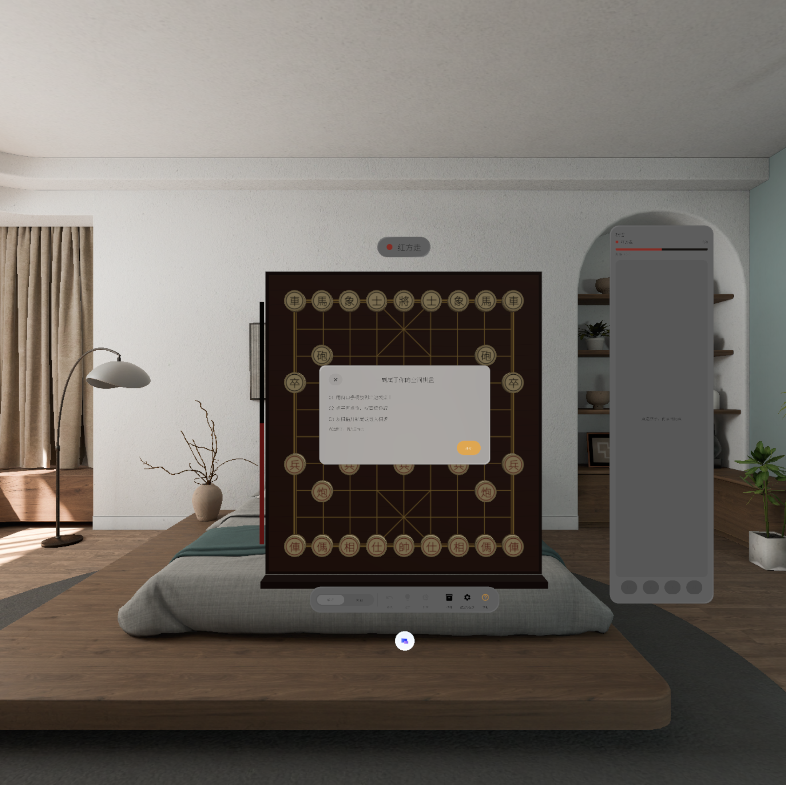
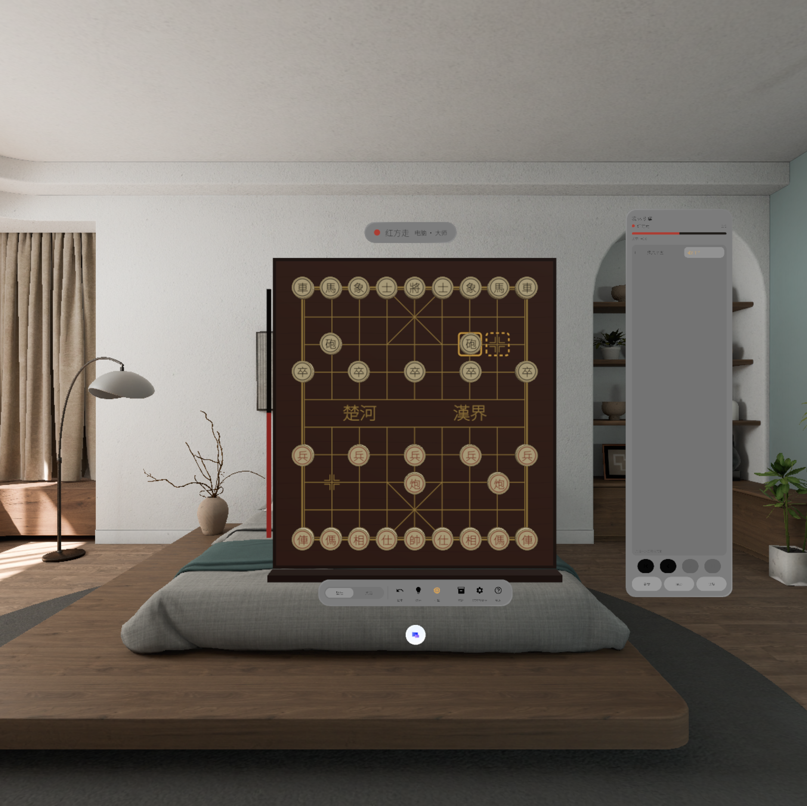
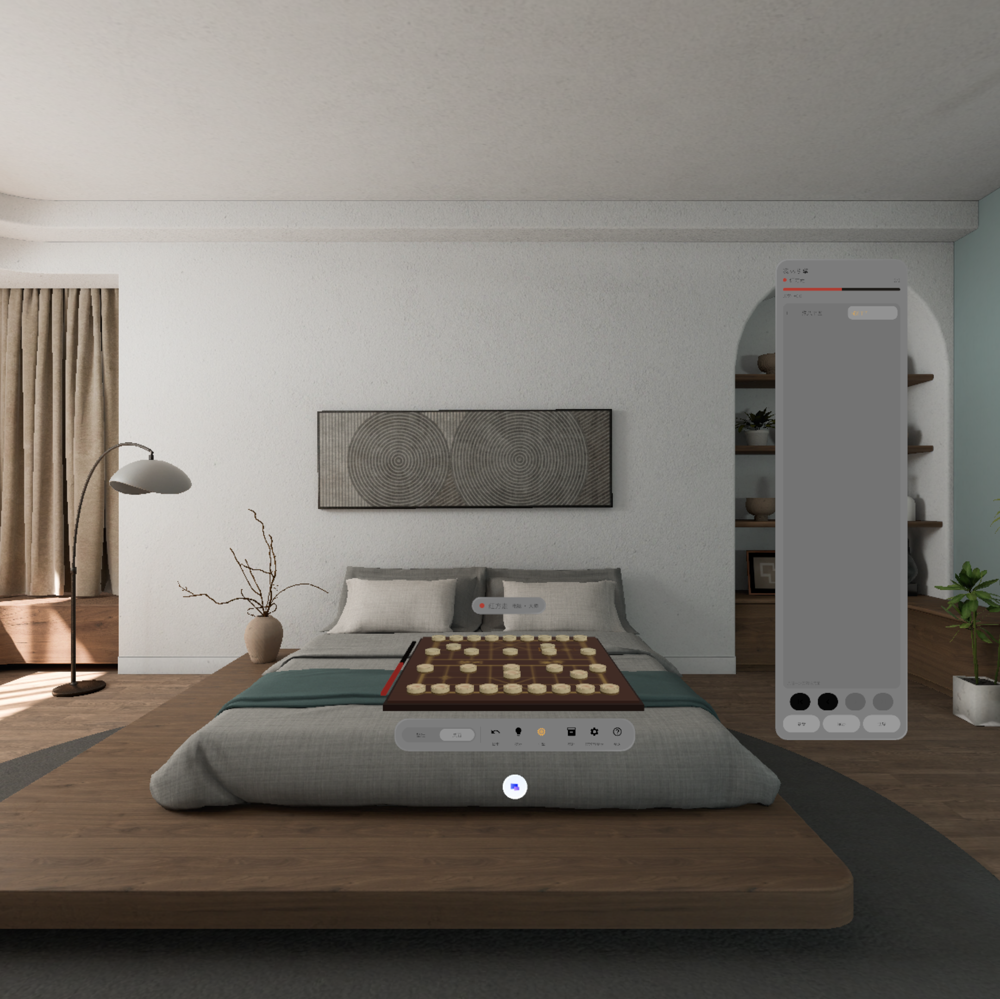
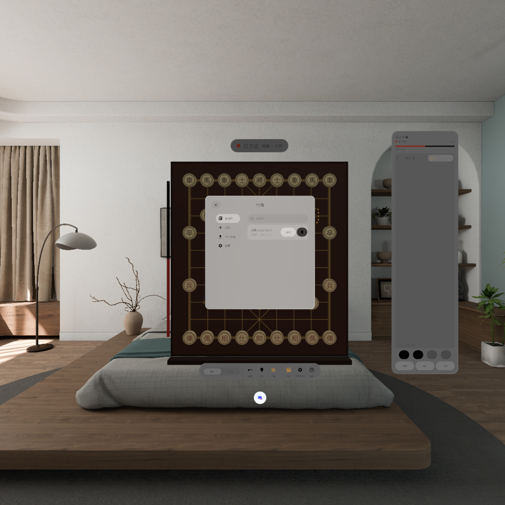

# 空间象棋 · Spatial Xiangqi

PICO Spatial SDK（6.1.9）中国象棋空间应用：棋盘可壁挂也可平放桌面，立体棋子，中英双语，本地五档 AI，复盘、摆子、棋谱库与 PGN 导入导出。

| 首次启动 | 壁挂对局 | 桌面模式 | 棋箱 |
| --- | --- | --- | --- |
|  |  |  |  |

- **窗口**：Shared Space 体积窗口 1.1 × 1.05 × 0.9 m，整体摆放用系统窗口手柄；「摆放与显示」里微调大小（80–140%）、朝向、高度、倾斜、坐标。
- **交互**：点子再点位；合法落点、吃子、上一步、将军、提示都在盘面上标出；侧边棋谱卷点任一步即可跳到该局面。
- **皮肤**：紫檀（默认）／竹林／楚汉烽烟；楚河汉界只留书法字。
- **AI**：本地 alpha-beta 引擎，入门／初级／中级／高级／大师，复盘时给出三条分析线与形势尺。

## 构建与验证

```bash
export JAVA_HOME="/Applications/Android Studio.app/Contents/jbr/Contents/Home"
./gradlew :app:assembleDebug
./gradlew :app:testDebugUnitTest
```

模拟器验证截图在 `docs/verification/`，发布包在 `releases/SpatialXiangqi-v0.1.0-debug.apk`。调试命令见 `AGENTS.md`。
